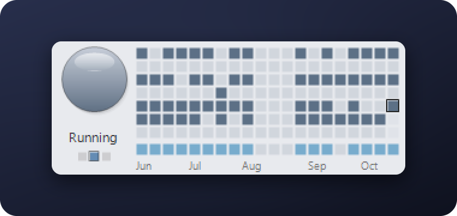
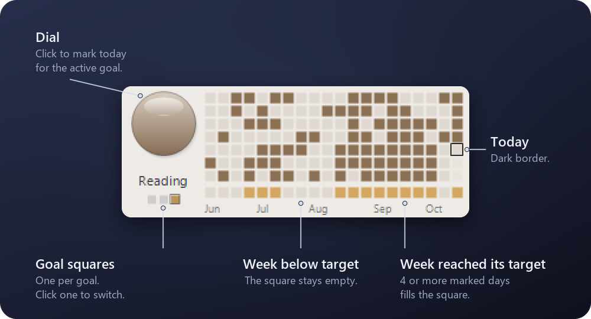
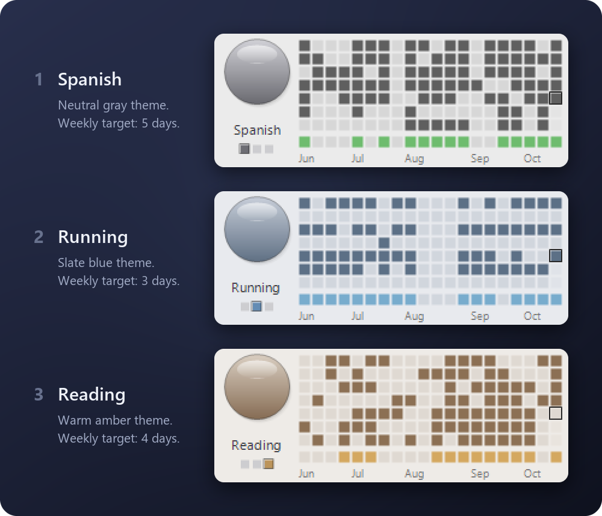

# Habit Tracker Widget for Windows

Habit Tracker Widget is a desktop habit tracker for Windows 10 and Windows 11. It follows several goals at once, each on a 20-week grid like a contribution graph, so every streak shows up as a run of filled squares. A weekly summary row fills when a week reaches your target, one click on the dial (or one global hotkey) marks today, and the widget sits below all your windows so it never steals focus. It is a single PowerShell and WinForms script: no installer, no account, no network access.



## Features

- Multiple goals in one widget (for example Spanish, Running, Reading). Switch with a single click.
- A 20-week activity grid per goal, in the style of a contributions calendar.
- A weekly summary row that fills with the goal's accent color once you reach your weekly target.
- A soft, distinct color theme per goal. The grid and the dial pick up the goal's hue.
- One-tap daily marking on the dial, plus a global hotkey (Ctrl+Alt+Shift+O).
- Sits below all windows, never steals focus, and stays out of the taskbar and Alt-Tab.
- Remembers its position and all data across reboots.
- Survives stray errors: an exception in a paint, timer or click is logged, not fatal.

## Install

Requirements: Windows 10 or 11 and Windows PowerShell 5.1 (built into Windows). No admin rights, no extra packages.

**From a release (recommended)**

1. Download `habit-tracker-widget-v1.1.0.zip` from [Releases](https://github.com/datonko-gi/habit-tracker-widget/releases).
2. Extract it anywhere, for example to `%USERPROFILE%\HabitWidget\`.
3. Double-click `install.bat`. It adds a shortcut to your Startup folder and launches the widget.

**From git**

```
git clone https://github.com/datonko-gi/habit-tracker-widget.git
cd habit-tracker-widget
.\install.bat
```

The widget then starts automatically on each login. Keep the folder where it is: the Startup shortcut points to it. If you move the folder, run `install.bat` again.

If Windows SmartScreen warns about the scripts, right-click the downloaded ZIP, choose Properties, tick Unblock, and extract again.

A fresh install starts with three goals named English, Push ups and Calories. Rename them, remove them, or add your own from the right-click menu.

## Usage

- **Left-click the dial** to mark today done for the active goal. If today is already marked, nothing changes; use right-click then Unmark today to undo.
- **Click a switcher square** to switch to that goal. **Click the goal name** to cycle to the next goal. The grid, the summary, the name, and the color theme all switch together.
- **Drag** (hold the left button and move) to reposition the widget. The position is saved.
- **Global hotkey Ctrl+Alt+Shift+O** marks today for the active goal from anywhere.
- **Right-click** for the menu:
  - the header shows the active goal and its position, for example `Spanish  (1/3)`
  - **Weekly goal: N days...** sets how many marked days fill that week's summary square (1 to 7, default 4)
  - **Rename goal...**, **Add goal...** and **Remove this goal** (it asks first, and the last goal cannot be removed)
  - **Unmark today**
  - **Close widget**

The dial is deliberately set apart from the name and the switcher, so picking a goal never marks a day by accident.

Only today can be marked or unmarked. To correct an earlier day, close the widget and edit `data.json` (see Configuration and data).

## Layout



- Left column: a dial (the day button), the active goal's name, and a row of small squares, one per goal, with the active one highlighted. The row has room for seven goals.
- Grid: 20 columns by 7 rows. Each column is a week (Monday at the top, Sunday at the bottom). The rightmost column is the current week, and history scrolls left as weeks roll over.
- Bottom row: the weekly summary. A week's square fills with the goal's accent color once that week has at least N marked days (configurable per goal, default 4).
- Month labels (Jun, Jul, and so on) sit under the week that contains the first day of each month.
- Today's cell carries a dark border that advances at midnight Pacific time.

## Goals and color themes



Each goal slot has its own muted theme (neutral gray, slate blue, warm amber, sage green, soft plum), cycling if you add more than five goals. The themes stay soft on purpose, so the widget reads as one calm surface rather than a row of bright badges.

## Timezone and rollover

All day and week math runs in Pacific Time and handles daylight saving automatically, whatever time zone your PC uses. A 30-second timer notices the date change and rotates the grid and the today-border right at midnight PT. To anchor to a different zone, change the time zone id in `habit_widget.ps1` (search for `Pacific Standard Time`). Valid ids are listed by `Get-TimeZone -ListAvailable`, for example `W. Europe Standard Time`. If the id is not found, the widget falls back to the PC's local time zone.

## Configuration and data

State lives at `%APPDATA%\HabitWidget\data.json`, never in this folder.

```json
{
  "version": 2,
  "active": 0,
  "goals": [
    { "name": "English",  "days": { "2026-04-14": true }, "threshold": 4 },
    { "name": "Push ups", "days": {}, "threshold": 4 },
    { "name": "Calories", "days": {}, "threshold": 4 }
  ],
  "posX": 1320,
  "posY": 20
}
```

- `days` holds one `"yyyy-MM-dd": true` entry per marked day. Days older than the 20 weeks on screen scroll off the grid but stay in the file.
- `threshold` is the weekly target (1 to 7).
- `posX` and `posY` are the window position. Delete them to put the widget back at its default spot near the top right of the primary screen.
- Edit the file only while the widget is closed, because the widget rewrites it on every change.
- A `version: 1` file from an earlier single-goal build is migrated automatically on first run: your existing goal becomes the first goal, and Push ups and Calories are added alongside it.

To change the hotkey, edit the two lines in the `Add_Shown` block of `habit_widget.ps1`: `$mods` (the modifier keys) and `$vkO` (the virtual-key code; `0x4F` is the letter O).

## How it works

The widget is a normal borderless form with the `WS_EX_NOACTIVATE | WS_EX_TOOLWINDOW` extended styles, pushed to the bottom of the z-order with `SetWindowPos(HWND_BOTTOM)`. The `NOACTIVATE` style means clicks register without the widget ever becoming the active window, so it never steals focus from the app you are using, and `TOOLWINDOW` keeps it out of the taskbar and Alt-Tab.

A 3-second timer keeps it underneath. Since v1.1.0 the tick looks at the window directly below the widget and re-sinks only when that is a normal application window, that is, when something was raised above it. The desktop itself and other WinForms widgets do not count. An unconditional re-sink on every tick made Windows redraw the window shadow each time, which showed up as blinking shadows.

The hotkey is registered with `RegisterHotKey`, and a small `NativeWindow` subclass turns `WM_HOTKEY` into a managed event. Everything is drawn with GDI+ in one double-buffered panel. The form asks DWM for rounded corners, which Windows 11 applies.

Unhandled UI-thread exceptions are caught and written to the log instead of ending the process. If a saved position lands outside every connected screen (for example after unplugging a monitor), the widget is moved back onto the primary screen at start.

## Privacy

- The widget reads and writes two files, both in `%APPDATA%\HabitWidget\`: `data.json` (goal names, marked dates, weekly targets, window position) and `widget.log` (start and close lines plus recovered errors; trimmed to the last 400 lines once it passes 200 KB).
- It makes no network calls: no telemetry, no update check, no account.
- `install.bat` creates one shortcut in your Startup folder. `uninstall.bat` removes it.

## Uninstall

Run `uninstall.bat`, then close the widget via right-click then Close widget (or reboot). To delete your data as well, remove the folder `%APPDATA%\HabitWidget\`.

## Troubleshooting

- **The widget is not visible after login or after changing monitors.** A saved position that is off every screen is moved back onto the primary screen at start. If it is still out of sight, end the `powershell.exe` process that runs `habit_widget.ps1` (Task Manager, Details tab), delete `posX` and `posY` from `data.json`, and start `HabitWidget.vbs` again.
- **The hotkey does nothing.** Another program already owns Ctrl+Alt+Shift+O, and Windows allows only one owner per key combination. Change the key as described under Configuration and data.
- **Today flips at the wrong hour.** Days roll over at midnight Pacific time by design. Change the time zone id as described under Timezone and rollover.
- **There are two widgets on top of each other, or marks seem to vanish.** Running `install.bat` or `HabitWidget.vbs` while the widget is already running starts a second copy, and both write to the same `data.json`. Close each copy with right-click then Close widget.

For anything else, look at `%APPDATA%\HabitWidget\widget.log`.

## Files

| file               | purpose                                                |
| ------------------ | ------------------------------------------------------ |
| `habit_widget.ps1` | main PowerShell and WinForms widget                    |
| `HabitWidget.vbs`  | silent launcher (no console window)                    |
| `HabitWidget.bat`  | alternative launcher (brief console flash, for debug)  |
| `install.bat`      | creates a Startup shortcut and launches the widget     |
| `uninstall.bat`    | removes the Startup shortcut                           |

## More widgets

This widget is part of a small set of PowerShell desktop widgets for Windows. The guide and the shared boilerplate are in [windows-desktop-widgets](https://github.com/datonko-gi/windows-desktop-widgets).

## Changelog

See [CHANGELOG.md](CHANGELOG.md).

## License

MIT. See [LICENSE](LICENSE).
